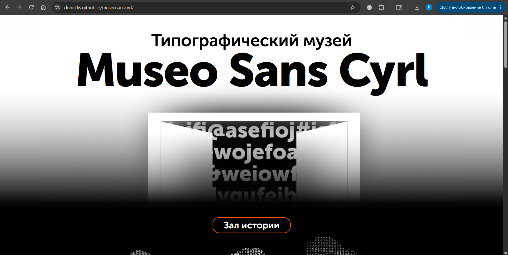

# [Типографический музей Mueo Sans Cyrl]

Сайт рассказывает и показывает различные особенности шрифта Mueo Sans Cyrl.

## Ссылка на сайт

https://doniikks.github.io/museosanscyrl/

## Скриншот

## Автор

Андросов Даниил, Б26ДЗ09

## Что я научился(ась) делать

- Получилось применить знания, полученные на парах, на практике
- Было трудно с верхним и нижним блоками, они плохо попадали, прибегнул к помощи ИИ, он помог разобраться и решить проблему
- Узнал как правильно импортировать шрифты, точнее какие проблемы могут возникнуть при импорте и как их избежать

## Использование ИИ

### Инструменты

| Инструмент | Для чего использовал(а)                     | Уровень помощи |
| ---------- | ------------------------------------------- | -------------- |
| Claude     | Помощь с написанием кода в трудных моментах | 3              |

### Записи о запросах

#### Запись №1 · [— ]

- **Что я хотел(а) сделать:** Нормально вписать верхний и нижний блоки
- **Что я спросил(а):** Помочь убрать границы блоков (визуально)
- **Что ответил ИИ:** Сказал что можно добавить изображения по бокам
- **Что я изменил(а) сам(а):** Добавил изображения
- **Как я понял(а), что это работает:** Открыл код в браузере

#### Запись №2 · [— ]

- **Что я хотел(а) сделать:** Сделать блок где можно изменять текст в зависимости от настроек шрифта
- **Что я спросил(а):** Написать код для блока
- **Что ответил ИИ:** Написал код для блока
- **Что я изменил(а) сам(а):** Вставил код
- **Как я понял(а), что это работает:** Открыл код в браузере

#### Запись №3 · [— ]

- **Что я хотел(а) сделать:** Анимации "пошатывания" картин
- **Что я спросил(а):** Изменить код для блока
- **Что ответил ИИ:** Изменил код для блока
- **Что я изменил(а) сам(а):** Поместил в папку разделенные изображения чтобы ИИ смог редактировать их отдельно, вставил код.
- **Как я понял(а), что это работает:** Открыл код в браузере

### Выводы

Местами ИИ ошибался и мне приходилось просить его исправить ошибки и ждать лимита. Просмотрев и проанализировав код я понял как может работать html в купе с CSS, до этого я думал что некоторые вещи при помощи этих инструментов сделать нельзя. Также я впервые передавал Zip архивы в работу ИИ и был удивлен результату. До этого проекта я относился к работе при помощи ИИ со скепсисом, теперь я вижу, что местами ИИ может быть неожиданно хорош.
